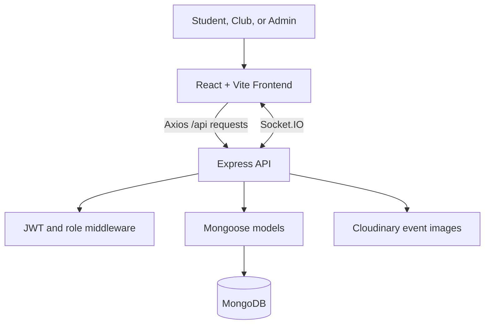

# CampusConnect

CampusConnect is a full-stack campus engagement platform for discovering and managing university events. Students can browse events, register for activities, manage their interests, and receive notifications. Clubs can publish events and manage participants, while administrators moderate users and events and review platform analytics.

The project was built to bring campus activities into one searchable, role-aware experience instead of relying on disconnected announcements and manual registration workflows.

**Repository:** [brijesh23-dev/CampusConnect](https://github.com/brijesh23-dev/CampusConnect)

> A hosted live demo is not currently configured in this repository. Follow the local setup instructions below to run the application.

## Features

- Role-based authentication for `student`, `club`, and `admin` users
- Public event and club discovery
- Event creation, image upload, editing, publishing, and moderation
- Student event registration, cancellation, and participant tracking
- Interest-based student experiences and dashboard analytics
- Club profiles and club-specific event analytics
- Notifications and real-time communication with Socket.IO
- Secure cookies, JWT authentication, CORS, Helmet, Joi validation, and centralized error handling
- Cloudinary integration for event images

## Tech Stack

| Area | Technologies |
| --- | --- |
| Frontend | React 19, Vite, React Router, Redux Toolkit |
| UI | Tailwind CSS, Chakra UI, Material UI, Radix UI, Lucide |
| Backend | Node.js, Express 5, CommonJS |
| Database | MongoDB with Mongoose |
| Authentication | JWT, HTTP-only cookies, bcrypt |
| Real-time features | Socket.IO |
| Media | Multer and Cloudinary |
| Validation and security | Joi, Helmet, CORS |
| Testing | Jest and Supertest |

## Architecture



The frontend communicates with the backend through Axios and includes credentials for HTTP-only authentication cookies. Express routes validate input, authenticate the request, enforce role permissions, and delegate to controllers. Controllers use Mongoose models for MongoDB access and Cloudinary for event image storage.

## Project Structure

```text
CampusConnect/
├── backend/
│   ├── src/
│   │   ├── config/          # Database, app, and Cloudinary configuration
│   │   ├── controllers/     # Request handlers
│   │   ├── middleware/      # Auth, validation, and error handling
│   │   ├── models/          # Mongoose schemas
│   │   ├── routes/          # Express route definitions
│   │   ├── socket/          # Socket.IO authentication and events
│   │   ├── utils/           # Async wrapper and API errors
│   │   └── validations/     # Joi request schemas
│   ├── tests/
│   ├── server.js
│   └── package.json
├── frontend/
│   ├── src/
│   │   ├── api/             # Axios client
│   │   ├── components/
│   │   ├── contexts/
│   │   ├── pages/
│   │   ├── redux/           # Store and feature slices
│   │   └── routes/
│   └── package.json
├── DEPLOYMENT.md
├── PROGRESS.md
└── README.md
```

## Getting Started

### Prerequisites

- Node.js 18 or newer
- npm 9 or newer
- MongoDB locally or a MongoDB Atlas connection
- A Cloudinary account if event image uploads are required

### 1. Clone the repository

```bash
git clone https://github.com/brijesh23-dev/CampusConnect.git
cd CampusConnect
```

### 2. Install dependencies

```bash
cd backend
npm install

cd ../frontend
npm install
```

### 3. Configure environment variables

Create `backend/.env`:

```env
NODE_ENV=development
PORT=5000
DB_URI=mongodb://localhost:27017/campusconnect
JWT_SECRET=replace_with_a_long_random_secret
JWT_EXPIRES_IN=7d
SALT_ROUNDS=10
FRONTEND_URL=http://localhost:5173
CLOUDINARY_CLOUD_NAME=your_cloud_name
CLOUDINARY_API_KEY=your_api_key
CLOUDINARY_API_SECRET=your_api_secret
```

Create `frontend/.env` with the backend origin only. The frontend adds `/api` automatically:

```env
VITE_API_URL=http://localhost:5000
```

Never commit either `.env` file or real credentials.

### 4. Run the application

Start the backend in one terminal:

```bash
cd backend
npm run dev
```

Start the frontend in another terminal:

```bash
cd frontend
npm run dev
```

The frontend is normally available at `http://localhost:5173` and the API at `http://localhost:5000`.

### 5. Production build

```bash
cd frontend
npm run build
```

For deployment-specific guidance, see [DEPLOYMENT.md](./DEPLOYMENT.md).

## Authentication

Authentication accepts either:

- The HTTP-only `token` cookie set by register/login; or
- `Authorization: Bearer <JWT>`

The frontend Axios client uses `withCredentials: true`. Protected endpoints return `401` when the token is missing, invalid, expired, or belongs to a deleted/session-invalidated user. Role-restricted endpoints return `403` when the authenticated user's role is not permitted.

### Example: register

```http
POST /api/auth/register
Content-Type: application/json

{
  "name": "Asha Student",
  "email": "asha@example.com",
  "password": "securepass",
  "role": "student"
}
```

Successful registration returns `201` with `success`, `message`, a public `user` object, and a JWT. The server also sets the HTTP-only `token` cookie.

### Example: login

```http
POST /api/auth/login
Content-Type: application/json

{
  "email": "asha@example.com",
  "password": "securepass",
  "rememberMe": false
}
```

### Common error response

```json
{
  "success": false,
  "message": "Validation failed",
  "errors": []
}
```

Error fields can vary by endpoint. In production, unexpected server errors are returned without stack traces.

## API Documentation

All routes below are prefixed with `/api`. Unless marked **Public**, an endpoint requires authentication. Role restrictions are enforced by the backend.

### Authentication

| Method | Endpoint | Access | Description |
| --- | --- | --- | --- |
| `POST` | `/auth/register` | Public | Create a student or club account. Required fields: `name`, `email`, `password`; optional `role` defaults to `student`. |
| `POST` | `/auth/login` | Public | Authenticate with `email`, `password`, and optional `rememberMe`. |
| `POST` | `/auth/logout` | Authenticated or session cleanup | Clear the authentication cookie. |
| `GET` | `/auth/getme` | Authenticated | Return the current user. |

### Events

| Method | Endpoint | Access | Description |
| --- | --- | --- | --- |
| `GET` | `/events/all` | Public | List events. |
| `GET` | `/events/:id` | Public | Get one event. |
| `POST` | `/events/create` | Club | Create an event. Accepts `multipart/form-data`; fields include `title`, `description`, `category`, `tags`, `date`, `startTime`, `endTime`, `venue`, optional `maxParticipants`, optional `status`, and an optional image file named `image`. Images are limited to 5 MB. |
| `PUT` | `/events/update/:id` | Club or admin | Update an event using the same validated event fields and optional image. |
| `DELETE` | `/events/delete/:id` | Club or admin | Delete an event. |
| `GET` | `/events/my-events` | Club or admin | List events associated with the authenticated user. |
| `POST` | `/events/:id/register` | Student | Register the current student for an event. |
| `GET` | `/events/:id/participants` | Club or admin | List event participants. |
| `PATCH` | `/events/:id/status` | Club | Update an event's status. |

Valid event categories are `Academic`, `Workshop`, `Technology`, `Social`, `Sports`, `Music`, `Business`, and `Arts`. Event times use `HH:mm`, dates use ISO format, and `endTime` must be after `startTime`.

### Clubs

| Method | Endpoint | Access | Description |
| --- | --- | --- | --- |
| `GET` | `/clubs/all` | Public | List clubs. |
| `GET` | `/clubs/:id` | Public | Get one club. |
| `GET` | `/clubs/profile` | Club | Get the authenticated club profile. |
| `PUT` | `/clubs/profile` | Club | Update `name`; optionally update `description`, `category`, and `website`. |

### Users and registrations

| Method | Endpoint | Access | Description |
| --- | --- | --- | --- |
| `PUT` | `/users/profile` | Authenticated | Update the user's `name`. |
| `PUT` | `/users/password` | Authenticated | Change password with `currentPassword` and `newPassword`. |
| `PUT` | `/users/interests` | Student | Replace interests with a non-empty `interests` array. |
| `GET` | `/registration/my-registrations` | Authenticated | List the current user's registrations. |
| `GET` | `/registration/participants/:eventId` | Authenticated | Retrieve participants for an event. |
| `DELETE` | `/registration/:id` | Authenticated | Cancel a registration. |

### Notifications and dashboards

| Method | Endpoint | Access | Description |
| --- | --- | --- | --- |
| `GET` | `/notifications` | Authenticated | List notifications for the current user. |
| `PUT` | `/notifications/:id` | Authenticated | Mark a notification as read. |
| `GET` | `/dashboard/analytics` | Club | Get club dashboard analytics. |

### Administration

| Method | Endpoint | Access | Description |
| --- | --- | --- | --- |
| `GET` | `/admin/stats` | Admin | Get platform statistics. |
| `GET` | `/admin/users` | Admin | List users. |
| `DELETE` | `/admin/users/:id` | Admin | Delete a user. |
| `PATCH` | `/admin/users/:id/role` | Admin | Update a user's role. |
| `GET` | `/admin/events` | Admin | List all events. |
| `DELETE` | `/admin/events/:id` | Admin | Delete an event as an administrator. |
| `PATCH` | `/admin/events/:id/approve` | Admin | Approve an event. |
| `GET` | `/admin/analytics` | Admin | Get platform analytics. |

## Testing

Backend tests use Jest, Supertest, and a MongoDB test connection configured by the test setup. From `backend/`:

```bash
npm test
```

The frontend provides linting and production build checks:

```bash
cd frontend
npm run lint
npm run build
```

## Deployment and Security Notes

- Use a strong, unique `JWT_SECRET` in production.
- Set `NODE_ENV=production` and use HTTPS for `FRONTEND_URL`.
- Configure CORS with the exact deployed frontend origin.
- Keep MongoDB, Cloudinary, and JWT credentials in the hosting provider's secret manager.
- Use MongoDB Atlas or another secured MongoDB deployment for production.
- Review [DEPLOYMENT.md](./DEPLOYMENT.md) before deploying.

## Future Improvements

- Add a dedicated API schema or OpenAPI document.
- Add pagination and filtering contracts to collection endpoints.
- Add automated frontend component and end-to-end tests.
- Add formal production observability and audit logging.

## Contributing

1. Fork the repository.
2. Create a feature branch:

   ```bash
   git checkout -b feature/your-feature-name
   ```

3. Make and test your changes.
4. Commit with a clear message.
5. Push the branch and open a pull request.

## License

No root-level license file is currently included. Add a `LICENSE` file before distributing the project under formal license terms.

## Author

**brijesh23-dev**

- GitHub: [@brijesh23-dev](https://github.com/brijesh23-dev)
